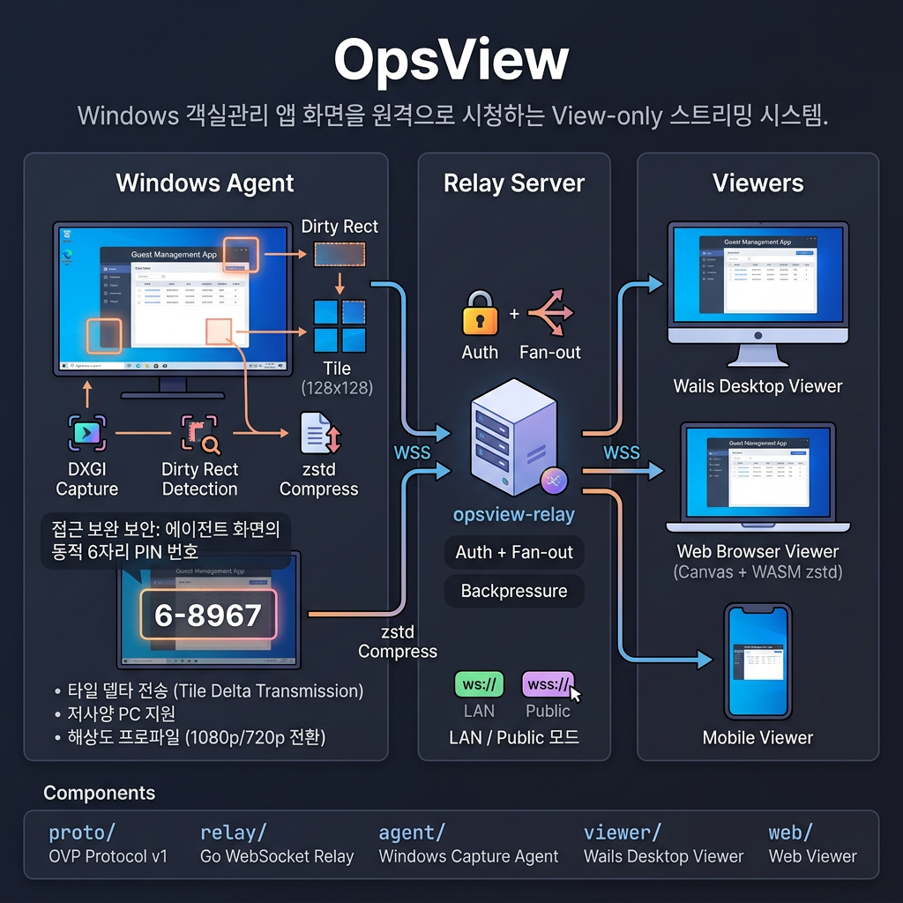
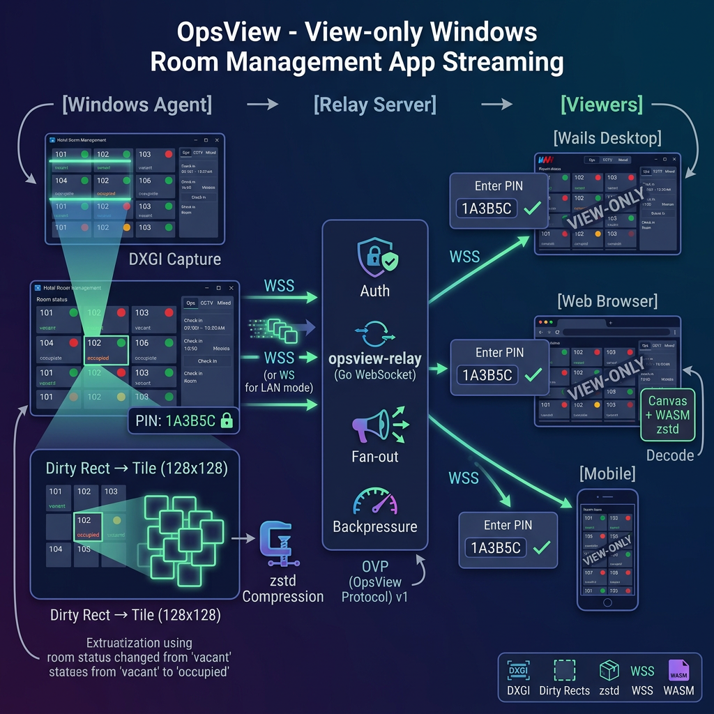

# OpsView

Windows 객실관리 앱 화면을 원격으로 시청하는 View-only 스트리밍 시스템.



## Architecture



- **타일 델타 전송**: 변경 영역(128x128)만 zstd 압축하여 전송 → 저사양 PC에서도 동작
- **LAN / Public 모드**: 내부 IP(`ws://`) 또는 공인 도메인(`wss://`) 모두 지원
- **해상도 프로파일**: 1080p / 720p 전환 가능
- **접근 보완 보안**: 에이전트 화면에 표시되는 동적 6자리 PIN 번호를 통해 Viewer 인증 통일

## Components

| Component | Path | Description |
|-----------|------|-------------|
| **proto** | `proto/` | OVP(OpsView Protocol) v1 바이너리 프로토콜 |
| **relay** | `relay/` | Go WebSocket 릴레이 서버 (인증, fan-out, backpressure) |
| **agent** | `agent/` | Windows 화면 캡처 에이전트 (DXGI Desktop Duplication) |
| **viewer** | `viewer/` | Wails 데스크톱 뷰어 (Ops / CCTV / Mixed 탭) |
| **web** | `web/` | 브라우저 웹 뷰어 (Canvas + WASM zstd) |

## Dashboard Live Grid

대시보드 로그인 후 지점의 라이브 탭을 열면, WS/MSE 재생이 가능한 브라우저에서 여러 채널이 데스크톱 최대 4개, 모바일 최대 2개의 WebSocket 연결을 공유합니다. 구독 수가 적은 정상 연결부터 배정해 한 연결의 영상 대기가 전체 채널에 영향을 주는 것을 줄입니다. 화면에 보이는 채널을 우선하며 동시 디코더 수는 데스크톱 12개, 모바일 4개로 제한하고 나머지는 순환합니다. 전체 화면 플레이어와 기존 클라이언트는 개별 스트림 연결을 유지합니다.

대시보드 전용 전송 규약:

- `GET /dashboard/api/live-grid-ws?agent=<agent-id>`를 WebSocket으로 업그레이드합니다. 대시보드 세션 쿠키로 인증하며 구독은 선택한 지점의 스트림에 한정됩니다.
- JSON 제어 메시지: `{"op":"sub","slot":1,"stream":"dvr1_ch1"}`로 구독하고 `{"op":"unsub","slot":1}`로 해제합니다. 슬롯은 1–65535 범위이며 서버는 연결당 최대 16개 구독을 허용합니다.
- 각 바이너리 응답은 **2바이트 big-endian 슬롯 번호 + 기존 fMP4 메시지**입니다. 슬롯별 초기화 세그먼트와 미디어 프래그먼트를 해당 채널의 MSE 플레이어에 순서대로 전달합니다.
- `flow=1`을 요청한 새 클라이언트에는 서버가 먼저 `{"op":"flow","window":262144}`를 보냅니다. 클라이언트는 폐기된 슬롯까지 포함해 받은 바이너리 바이트의 누적 합을 `{"op":"ack","received":12345}`로 확인합니다. 미확인 영상은 연결당 256KiB와 한 패킷까지만 전송하며, 한도에 도달해도 구독 변경·종료·핑은 처리합니다. 구버전 서버가 협상 메시지를 보내지 않으면 ACK 없이 기존 방식으로 동작합니다.
- 공유 연결이 열리기 전에 실패하거나 6초 연결 제한을 넘기면 다른 정상 공유 연결을 우선합니다. 모든 공유 연결이 불가능하면 이후 시작은 기존 개별 스트림 경로를 사용합니다. 슬롯 번호를 재사용하기 전에는 공유 연결을 새로 만들어 이전 연결의 프레임과 섞이지 않게 합니다.

## Quick Start

```bash
# 0) Publisher 시크릿 설정 (필수). relay와 agent가 동일한 값을 사용해야 합니다.
#    미설정 시 relay는 기동을 거부합니다(fail-closed).
export RELAY_PUBLISHER_TOKEN=$(openssl rand -hex 16)

# 1) Relay 시작
cd relay
go build -o opsview-relay .
./opsview-relay

# 2) Agent 시작 (같은 RELAY_PUBLISHER_TOKEN 환경에서)
cd agent
go build -o opsview-agent .
./opsview-agent

# 3) 브라우저에서 시청 (에이전트에 표시된 6자리 PIN 입력)
open http://127.0.0.1:8080
```

> **보안:** `RELAY_PUBLISHER_TOKEN`은 publisher(agent)만 아는 공유 시크릿으로, 시청자 PIN과 별개입니다. 시청자는 여전히 6자리 PIN으로 인증합니다.

## Environment Variables

```bash
# Relay
RELAY_PORT=8080
RELAY_PUBLISHER_TOKEN=your-secret

# Agent
AGENT_RELAY_URL=ws://127.0.0.1:8080/publish
AGENT_TOKEN=your-secret
AGENT_PROFILE=1080   # or 720

# Viewer
WATCH_URL=ws://127.0.0.1:8080/watch
WATCH_TOKEN=pin-number
```

See [`.env.example`](.env.example) for full list.

## Documentation

- [Build & Run Guide](docs/BUILD.md)
- [OVP Protocol Spec](docs/PROTOCOL.md)

## License

Private - All rights reserved.
